# System map: guard-generalization-study

Each diagram shows one real path through this repository. A highlighted box is a step that can reject its input; a vertical bar marks the boundary between zones.

[Back to the README](../README.md)

## Fetching the public corpus

The fetch command is the only step that uses the network. It can request only the files named in the built-in source lock, and every answer is checked before it is saved.

<picture>
  <source media="(prefers-color-scheme: dark)" srcset="system-map/fetch-source-lock-dark.svg">
  
</picture>

Source: [`guardstudy/acquire.py`](../guardstudy/acquire.py), [`docs/threat-model.md`](../docs/threat-model.md), [`tests/test_acquire.py`](../tests/test_acquire.py)

## From raw files to a frozen protocol

Four commands turn the raw files into a protocol that binds the dataset, the private exposure audit and the exact model files. Each one writes into a new directory.

<picture>
  <source media="(prefers-color-scheme: dark)" srcset="system-map/prepare-and-freeze-dark.svg">
  
</picture>

Source: [`guardstudy/cli.py`](../guardstudy/cli.py), [`guardstudy/acquire.py`](../guardstudy/acquire.py), [`guardstudy/exposure.py`](../guardstudy/exposure.py), [`guardstudy/protocol.py`](../guardstudy/protocol.py)

## The only command that runs a model

The coordinator never imports MLX. It checks the frozen bindings, then supervises one worker process that scores every prompt with base and then LoRA v2, and keeps every row whatever happened.

<picture>
  <source media="(prefers-color-scheme: dark)" srcset="system-map/run-inference-dark.svg">
  
</picture>

Source: [`guardstudy/runner.py`](../guardstudy/runner.py), [`guardstudy/worker_mlx.py`](../guardstudy/worker_mlx.py), [`guardstudy/protocol.py`](../guardstudy/protocol.py), [`tests/test_runner.py`](../tests/test_runner.py)

## What seal writes and in what order

Evaluate rebuilds the report from saved predictions. Seal does the same, refuses fixture output, writes every artifact as a new file and links the manifest last, so a visible manifest means a complete bundle.

<picture>
  <source media="(prefers-color-scheme: dark)" srcset="system-map/seal-bundle-layout-dark.svg">
  
</picture>

Source: [`guardstudy/recorded.py`](../guardstudy/recorded.py), [`guardstudy/io.py`](../guardstudy/io.py), [`docs/design.md`](../docs/design.md), [`tests/test_recorded.py`](../tests/test_recorded.py)

## How a damaged bundle is rejected

Verify and report read the bundle once into memory and check that same snapshot. Any extra file, symlink, wrong hash or report that does not match the saved predictions stops with a closed error code and exit 2.

<picture>
  <source media="(prefers-color-scheme: dark)" srcset="system-map/verify-rejects-damage-dark.svg">
  
</picture>

Source: [`guardstudy/recorded.py`](../guardstudy/recorded.py), [`guardstudy/io.py`](../guardstudy/io.py), [`guardstudy/cli.py`](../guardstudy/cli.py), [`tests/test_recorded.py`](../tests/test_recorded.py)

## Which file does which step

The package follows the artifact flow. cli.py dispatches the ten phase commands, io.py and schemas.py hold the strict JSON and create-only writes used by every step.

<picture>
  <source media="(prefers-color-scheme: dark)" srcset="system-map/module-map-dark.svg">
  
</picture>

Source: [`guardstudy/cli.py`](../guardstudy/cli.py), [`guardstudy/io.py`](../guardstudy/io.py), [`guardstudy/schemas.py`](../guardstudy/schemas.py), [`guardstudy/metrics.py`](../guardstudy/metrics.py), [`guardstudy/summary.py`](../guardstudy/summary.py)

## How it is verified

Every push runs the Python tests on two versions, verifies the real recorded bundle and rebuilds the viewer to confirm it is byte for byte the published one.

<picture>
  <source media="(prefers-color-scheme: dark)" srcset="system-map/ci-checks-dark.svg">
  
</picture>

Source: [`.github/workflows/checks.yml`](../.github/workflows/checks.yml), [`docs/verification.md`](../docs/verification.md), [`tests/test_recorded.py`](../tests/test_recorded.py), [`showcase/test_build_assets.py`](../showcase/test_build_assets.py)
